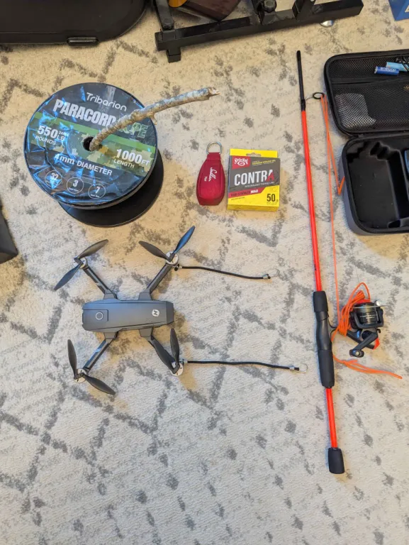
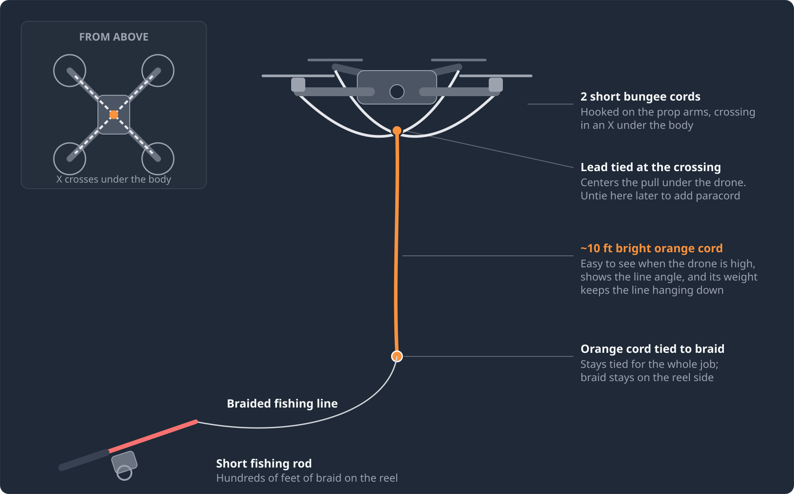
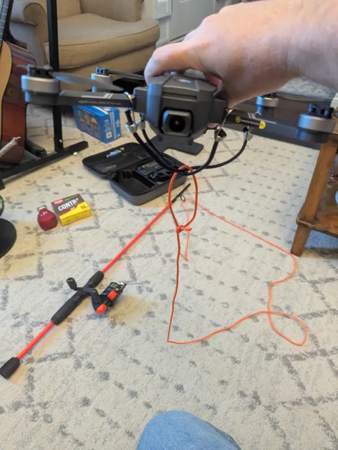

# Getting a Line into a Tree: A Drone Method

A [tree node](diy-tree-node.md) only helps the network if it gets up high, ideally above the canopy. The hard part usually isn't the node - it's getting a rope over a branch 40, 60, or 80 feet up. Throw bags and slingshots run out of reach fast, and climbing is its own project.

This page covers a method that has worked for me: a cheap drone carries a light fishing line over the branch, the fishing line pulls a paracord loop back over, and the paracord does the actual lifting. It has worked about half a dozen times now. It's one way to do it, not the way - there are endless variations on the rig, the flight path, and the hoist, so adapt it to your tree, your yard, and your gear. My drone isn't too pricey, so I don't sweat it if something goes sideways - and that's the right mindset for this. Use a drone you can afford to lose.

---

## Gear

--8<-- "affiliate.md"

| Item | Purpose | |
|---|---|---|
| Small drone | Carries the line up and over the branch. Mine is a Holy Stone HS720E (I got it on sale for about $75). | [Amazon](https://www.amazon.com/dp/B085HNMHKJ?tag=csrameshcore-20){ .md-button .md-button--primary } |
| 2 short bungee cords (10") | Hooked on the prop arms to make an X under the drone - the line hangs from where they cross | [Amazon](https://www.amazon.com/dp/B08L3Z89G6?tag=csrameshcore-20){ .md-button .md-button--primary } |
| ~10 ft of bright orange cord | The "lead" line under the drone. Easy to see high up, and its weight keeps the line hanging down. Neon orange paracord works well. | [Amazon](https://www.amazon.com/dp/B00GG0RLMI?tag=csrameshcore-20){ .md-button .md-button--primary } |
| Braided fishing line | Light and strong, runs from the orange cord back to the reel. I use 50 lb Strike King Contra, but pick whatever strength you like. | [Amazon](https://www.amazon.com/dp/B098SJ1ZZC?tag=csrameshcore-20){ .md-button .md-button--primary } |
| Short fishing rod and reel | Holds hundreds of feet of braid and lets you pay out and reel in under control. The cheapest combo with a spinning reel is fine - mine came from a Walmart bargain bin for about $15. | [Amazon](https://www.amazon.com/dp/B0D154R396?tag=csrameshcore-20){ .md-button .md-button--primary } |
| 4mm camo paracord, 200 ft | The line that ends up over the branch and lifts the node. Camo blends in. For the loop you need a bit more than **twice the branch height**, and 200 ft covers most trees. | [Amazon](https://www.amazon.com/dp/B0FPX8SJKV?tag=csrameshcore-20){ .md-button .md-button--primary } |

{ .constrained-image }

---

## Rigging the Drone

Hook the two short bungees onto the prop arms so they form an **X under the drone**. Tie the ~10 ft of bright orange cord to the crossing point, then tie the bottom of the orange cord to the braided line coming off the rod.

{ .constrained-image }

The orange cord earns its place three ways:

- **Visibility** - braid is nearly invisible against the sky. The orange cord shows you exactly where your line is when the drone is high up.
- **Line angle** - you can see whether the line is hanging straight down (plenty of slack) or trailing back hard (you're close to your limit).
- **Ballast** - its weight keeps the line hanging below the drone as long as there's slack, so it's less likely to drift up toward the props.

!!! warning "Keep the line clear of the props"
    Before takeoff, lay the orange cord and braid out on the ground away from the drone so nothing can get pulled up into the props as it lifts off. Leave the bail open (or drag set very light) so line pays out freely as you climb.

---

## Flying the Line Over

The diagram shows one layout: you stand on one side of the tree with the rod, fly out over the branch, and land on the far side.

1. **Climb above the branch.** Fly up and over your branch of interest, getting well clear of the canopy.
2. **Drag through horizontally, well above it.** Don't try to thread the needle right over the branch. Pull up above it, then fly through horizontally a good ways above, in the direction you want the line to go.
3. **Keep going until you have enough slack to reach the ground.** Watch the orange cord here. If it's trailing back hard toward the tree, you're getting close to your limit and need to be higher.
4. **Ease back, then descend.** Move back closer to the original branch so the line has slack, then come down. Land on the other side of the branch from where the line started.

!!! danger "Descent is where it goes wrong"
    Be very careful coming down. If the drone descends without enough slack, the line goes tight over the branch and pulls the drone toward the tree. Come down slowly, keep an eye on the orange cord, and stop and move back toward the branch if it starts trailing back again.

### Variations

The direction doesn't matter much. What matters is the same in every version:

- The line crosses **over the branch you want**, with the drone **well above** it as it passes.
- There's **enough slack** paid out for the drone to reach the ground on the other side.
- The drone **never descends against a tight line**.

For example, you can fly the drone out to the far side of the tree, climb there, and then drag back over the branch toward yourself, pulling slack your way. The drone lands near you, so the paracord swap and the reeling happen in the same spot. Pick whatever direction suits the clear landing spots, obstacles, and sight lines around your tree.

---

## Swapping to Paracord

1. **Untie the drone.** Once the drone is back on the ground, take the orange cord off the drone. The drone's job is done.
2. **Tie on the paracord.** Tie your paracord to the free end of the orange cord.
3. **Reel her in!** Go back to the fishing rod side and reel in. The braid pulls the orange cord, then the paracord, up and over the branch and back down to you.
4. **Tie the ends together into a loop.** With both ends of the paracord on the ground, tie them together so you have one continuous loop running over the branch, like a flagpole halyard. Now you can raise and lower whatever you want easily.

---

## Hanging the Node

Hang the node flagpole style: tie it onto one side of the loop, then pull down on the other side to run it up to the branch. Tie the loop off to the trunk or a stake so it can't creep back down. For tying and orienting the Harbor Breeze tree node so the antenna hangs straight up, see [Step 12 of the tree node build](diy-tree-node.md#step-12-hang-with-paracord-and-set-final-orientation).

Because the loop stays over the branch, you can run the node back down later for a firmware update or battery swap and send it right back up - no drone needed the second time. The node never has to be the thing holding the line over the branch, so you can untie it and swap in a different one at ground level.

!!! tip "Higher is better"
    Getting above the canopy makes a dramatic difference in wooded areas. See [Getting More Range: Go Higher](network.md#getting-more-range-go-higher).

---

## Safety and Common Sense

- **Power lines** - never fly near them or put a line anywhere it could drift onto one. Pick a different tree.
- **Permission** - only do this on property where you have the owner's OK to fly and to hang a node.
- **Drone rules** - just stay within them. My drone is under 250 g and limits itself to 400 ft, so there's nothing extra to worry about. If you use something else, make sure you follow the [FAA's recreational flyer rules](https://www.faa.gov/uas/recreational_flyers).
- **Wind** - calm days only. Wind pushes on the drone and the line and makes the descent much harder to judge.
- **A helper makes it much easier** - a second person can hold and manage the fishing pole while you focus on flying, letting line out and keeping tension off the drone. They can also watch the line from the side and tell you whether you're actually above the branch.
- **Towing always carries some risk** - a line hanging off a drone can snag or pull it off course, so choose a drone you'd be comfortable risking. Inexpensive is good, but it also needs enough power to fly stably while towing. Mine can lift about 330 g (a bit less on hot days), which has been plenty.
