# RF Filters and Noise Floor

If your node sits near a cell tower, a water tower full of commercial antennas, or any other high-power transmitter, you may be losing traffic you never knew was there. A cheap bandpass filter can fix that. This page walks through a real-world test of a compact 915 MHz filter. If you want to know *why* it works, the [How It Works](#how-it-works-noise-floor-rssi-and-snr) section at the end digs into noise floor, RSSI, and SNR.

--8<-- "affiliate.md"

---

## The Filter

The filter tested here is a small inline SMA bandpass filter centered on the 915 MHz band. It screws in between the radio and the antenna and passes the LoRa band while rejecting strong signals outside it.

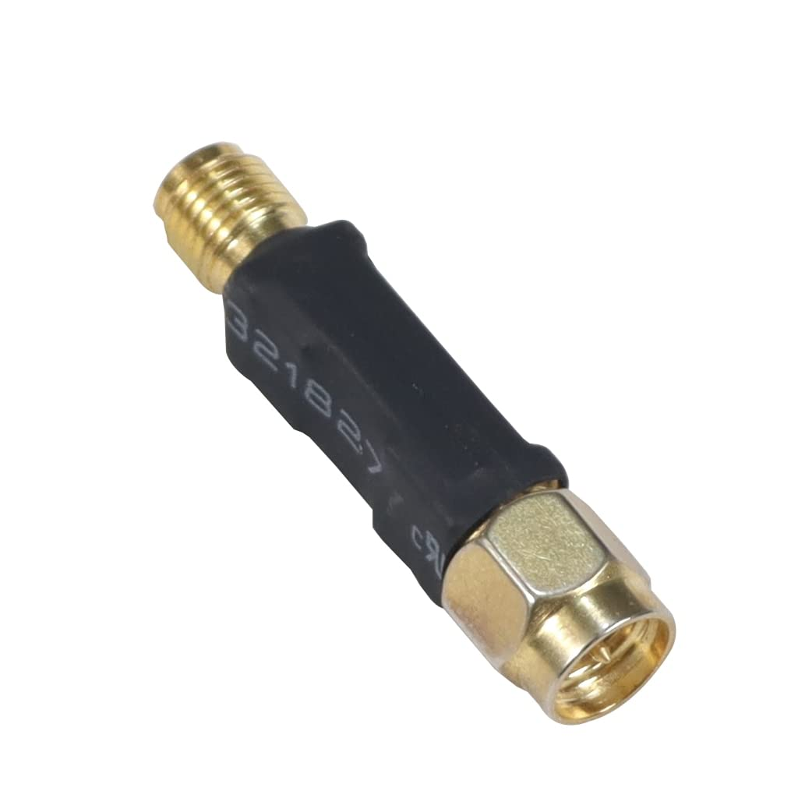{ .product-image }

**Model:** JMT Bandpass Filter, 915 MHz variant | **Connectors:** SMA male / SMA female | **Rated power:** up to 1 W

[Amazon](https://www.amazon.com/dp/B0BPCFHFLK?tag=csrameshcore-20){ .md-button .md-button--primary }

The vendor rates the passband as **902-928 MHz**, which is the full US ISM band that MeshCore uses.

In short: about **1.5 dB** of loss across the LoRa band, and **45 dB or more** of rejection below about 886 MHz and above about 954 MHz. See the [measured response](#the-tested-filters-measured-response) below.

---

## The 30-Second Primer

Three numbers matter for this test:

- **Noise floor** - the background noise your radio hears when nothing is transmitting. It's a negative number in dBm, and **more negative is better**. A quiet location reads about -115 to -120.
- **RSSI** - how strong an incoming signal is when it reaches your radio, also in dBm.
- **SNR** - how far the signal sits above the noise floor: **SNR = RSSI - Noise Floor**. **+5 dB or better is solid.** Around zero gets unreliable, and well below zero means the packet is lost.

!!! warning "Why it matters"
    The closer the noise floor gets to the incoming signal, the worse reception gets. First packets start dropping and links become unreliable. Push the noise floor high enough and the radio **can't detect or decode the packet at all** - there's simply **no RX**, and as far as your node is concerned, the other node doesn't exist.

The diagram below shows the same signal in two places. Nothing about the signal changes - only the noise floor - and that alone is enough to lose the link:

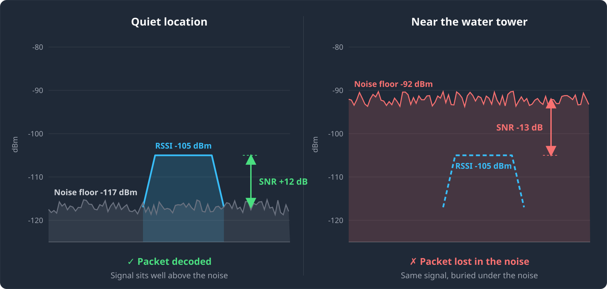

So where does a raised noise floor come from? Powerful transmitters - even ones on completely different frequencies - can overload a radio's front end and raise its noise floor. A bandpass filter blocks those signals before they reach the radio. More on that in [How It Works](#how-out-of-band-interference-raises-the-noise-floor).

---

## The Test

### Setup

The test node was the vehicle roof-mount node I typically use for war driving the [AGS MeshMapper](https://ags.meshmapper.net) coverage map (see [Resources](resources.md)). The target was the Grovetown water tower - a classic example of a site loaded with commercial antennas. Once there, I parked at the test location so every measurement below was taken from the same spot.

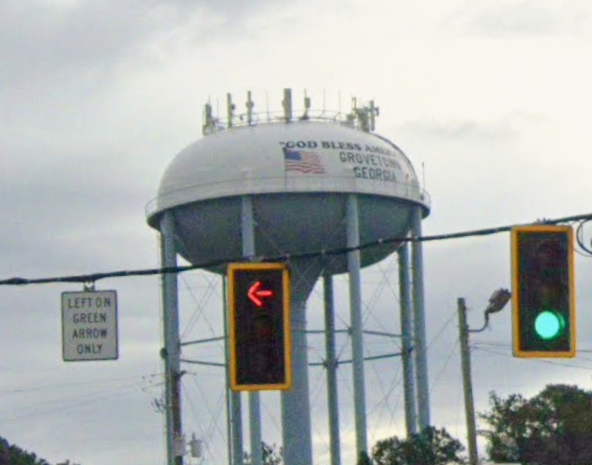{ .constrained-image }

### Driving in: watching the noise floor climb

The chart below is the noise floor logged by the node on the drive toward the tower. For the first ~13 minutes it sits right where you would expect, around **-117 to -118**. As the vehicle approaches the tower it climbs steadily, passing -100 and continuing up into the -90s and beyond.

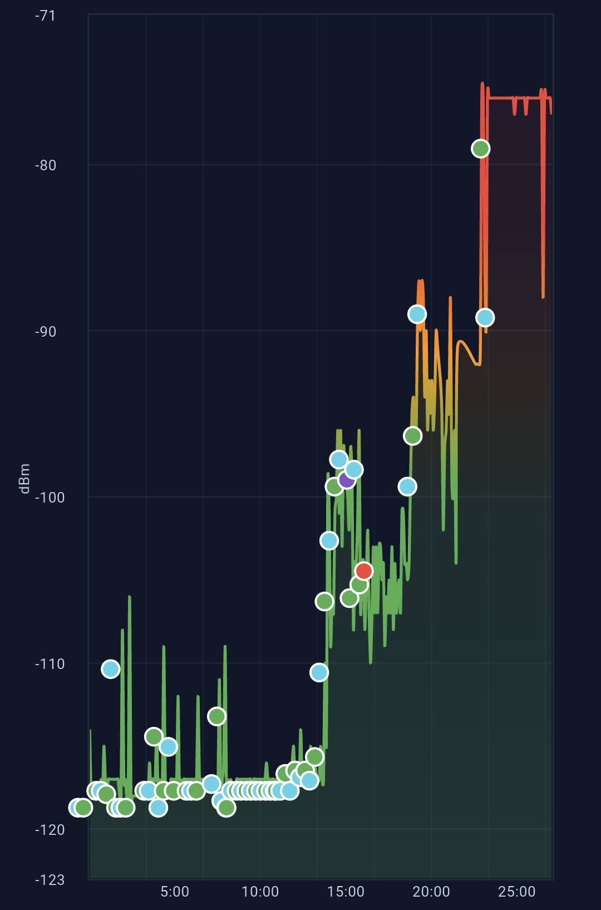{ .phone-screenshot }

Parked at the test location, the noise floor was about **-92** - roughly **25 dB higher** than the normal -117. That is over 300 times more background noise for every MeshCore packet to compete with.

### Adding the filter: the noise floor drops

Still parked in the same spot, I screwed the filter in. The noise floor dropped almost instantly from about **-92** back to about **-117**, the same level it read before I approached the tower:

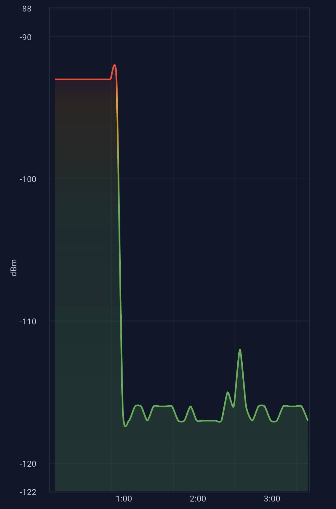{ .phone-screenshot }

That's the headline result. The rest of the test checks what that 25 dB drop means for actually using the mesh: how many repeaters I can hear, and whether the filter costs me anything on transmit.

### Discovery: 2 repeaters vs. 5

I ran a repeater discovery from the test location with and without the filter. Without it, only **two** repeaters answered - both strong, nearby nodes. With the filter, the same discovery found **five**.

<div class="screenshot-row screenshot-row--wide" markdown>
<figure markdown>
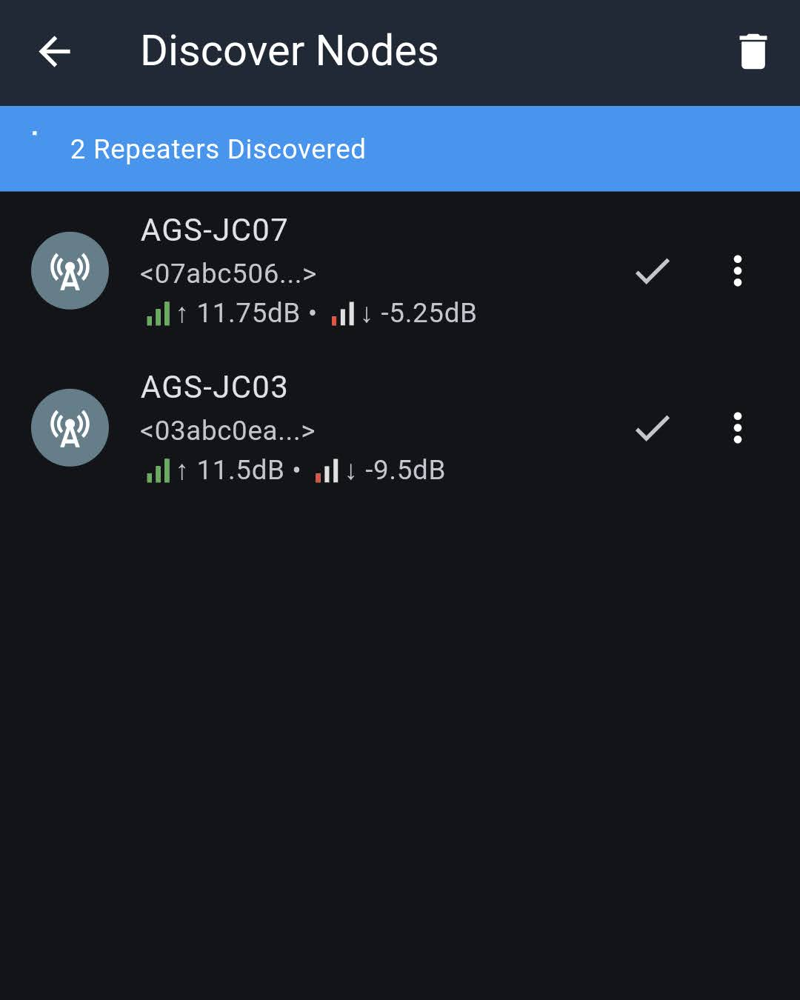
<figcaption>Without filter - 2 repeaters</figcaption>
</figure>
<figure markdown>
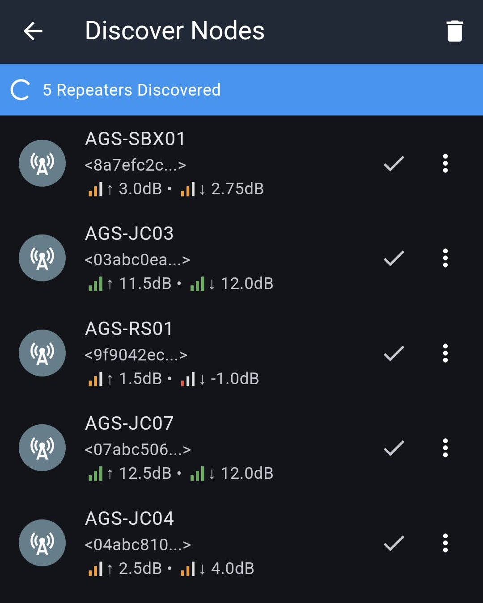
<figcaption>With filter - 5 repeaters</figcaption>
</figure>
</div>

Each discovery result shows two SNR values: **↑** is how well the repeater heard my node, and **↓** is how well my node heard the repeater's reply. Remember: **+5 or better is solid**, below zero is unreliable, and the displayed SNR [tops out around 12-14 dB](#why-snr-tops-out-around-13-14-db) even when the real signal is much stronger.

| Repeater | Without filter (↑ / ↓) | With filter (↑ / ↓) |
|---|---|---|
| AGS-JC07 | 11.75 / **-5.25** | 12.5 / **12.0** |
| AGS-JC03 | 11.5 / **-9.5** | 11.5 / **12.0** |
| AGS-SBX01 | not heard | 3.0 / 2.75 |
| AGS-RS01 | not heard | 1.5 / -1.0 |
| AGS-JC04 | not heard | 2.5 / 4.0 |

This table tells the whole story:

- The **↑ column barely changes**. The repeaters are not near the water tower, so their noise floor was fine all along. They could hear me.
- The **↓ column jumps dramatically**. JC03 went from -9.5 dB (barely decodable) to 12.0 dB ([pegged at the SNR ceiling](#why-snr-tops-out-around-13-14-db)). The true improvement is likely close to the full 25 dB of noise floor drop - the displayed number just can't go any higher.
- Three repeaters went from **invisible to reachable**. Their replies were always arriving - they were just buried under 25 dB of extra noise.

### Does the filter hurt transmit power?

The filter adds about 1.5 dB of loss in both directions, including on transmit. To check how much that matters, I logged into repeaters with the filter on and noted the RSSI they reported for my node (**Last RSSI** on the repeater status screen is how strongly the repeater heard me). Then I removed the filter and repeated the measurement.

<div class="screenshot-row" markdown>
<figure markdown>
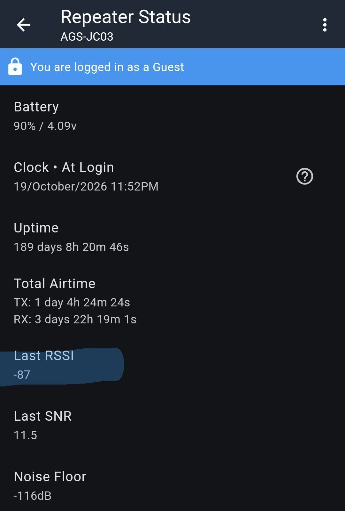
<figcaption>JC03 with filter - RSSI -87</figcaption>
</figure>
<figure markdown>
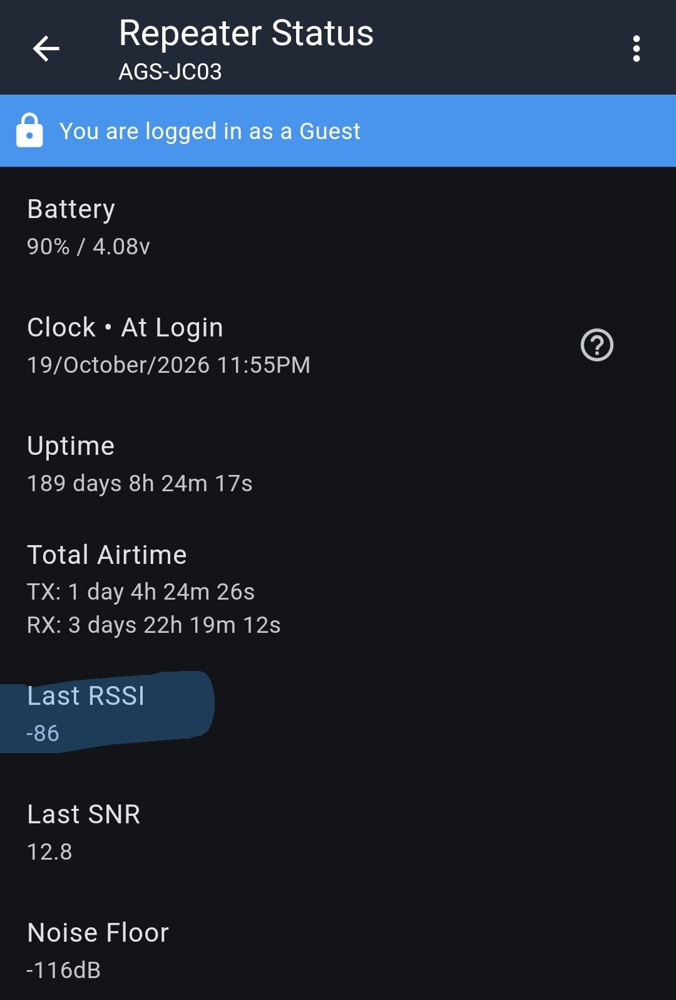
<figcaption>JC03 without filter - RSSI -86</figcaption>
</figure>
<figure markdown>
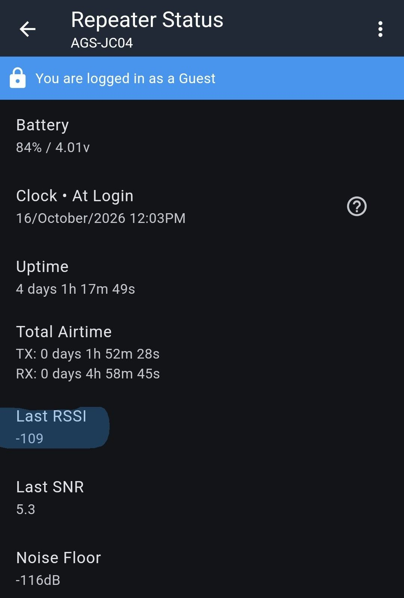
<figcaption>JC04 with filter - RSSI -109</figcaption>
</figure>
</div>

| Repeater | RSSI with filter | RSSI without filter |
|---|---|---|
| AGS-JC03 | -87 | -86 |
| AGS-JC04 | -109 | could not connect |

On JC03 the signal was **1 dB** weaker with the filter in place - right in line with the filter's ~1.5 dB insertion loss (RSSI is reported in whole dB). That's the entire transmit-side cost of the filter: a small, predictable loss.

Without the filter, I **couldn't log into JC04 at all**. That's no surprise: with the filter on, JC04's replies showed a ↓ SNR of 4.0 against a -117 noise floor, putting them around -112 at my node. Against a -92 noise floor, that's an SNR of roughly **-20 dB** - far below anything LoRa can decode. With the filter, the same reply landed against a -117 noise floor and came through fine.

---

## Conclusions

!!! success "Key takeaways"
    - **Nearby high-power transmitters can raise your noise floor dramatically** - 25 dB in this test - even though they are not on the LoRa frequency.
    - **A raised noise floor silently kills weak links.** The repeaters were still hearing me; I just couldn't hear them back.
    - **A cheap bandpass filter fixed it**, taking the noise floor from -92 back to -117 and the discovered repeater count from 2 to 5.
    - **The 1.5 dB insertion loss is a non-issue** when you are fighting 25 dB of interference. Measured transmit RSSI dropped about 1 dB, matching the expected insertion loss.

### When should you use a filter?

- **Yes:** nodes near cell towers, water towers, broadcast sites, rooftops with other antennas, or anywhere your noise floor sits well above -110.
- **Probably not:** nodes in quiet locations already seeing -115 to -120. There's no noise to remove, so you only pay the 1.5 dB loss.

!!! tip "Check your own noise floor"
    Log into your repeater (or check your companion's radio stats) and look at the noise floor. If it reads -105 or higher, a filter is very likely worth trying. The easiest test is the one done here: note the noise floor, add the filter, and see how far it drops.

### Limitations of this filter

The passband is 902-928 MHz, but the skirts are gradual. Full 45 dB rejection isn't reached until below about 886 MHz or above about 954 MHz ([measured response](#the-tested-filters-measured-response)), and the upper skirt has a shoulder near 940-948 MHz where rejection is only about 17 dB. Strong signals just outside the ISM band (for example, cellular downlinks near 890 MHz or paging and land-mobile systems in the 929-940 MHz range) are only partially attenuated. If you are near that kind of transmitter, a filter with steeper skirts, like a [cavity filter](#other-filter-options), will do better.

!!! warning "Power handling"
    The filter sits in the transmit path too, so it has to handle your full output power. This model is rated for up to **1 W**, which covers a stock node and a [1W booster](diy-rak1watt.md). Be careful as you approach that limit, though - running a filter at or near its maximum rating can damage it. For any other filter, check the power rating before putting it on a high-power node.

---

## How It Works: Noise Floor, RSSI, and SNR

This section is for anyone who wants the details behind the test results above.

### What is the noise floor?

The **noise floor** is the level of background RF energy your radio hears when nobody is transmitting a LoRa packet. Some of it is unavoidable thermal noise generated by the radio itself. The rest comes from the environment: nearby electronics, power lines, and - the subject of this page - powerful transmitters on other frequencies that leak through or overload the radio's front end.

MeshCore reports it as a negative number (in dBm). **More negative is better.**

| Noise floor | What it means |
|---|---|
| -115 to -120 | Quiet - typical for a node away from heavy RF sources |
| -105 to -115 | Some local noise - weak signals start to suffer |
| -105 and up | Noisy - only strong, nearby nodes get through |

The radio has to hear a packet *above* this background noise. Raise the noise floor and every weak signal you used to hear just disappears into it.

!!! note "Nodes with a receive pre-amp read higher"
    Some boards (e.g. Heltec V4 and T096) add an external LNA, a receive pre-amp, that boosts both signal *and* noise. The displayed noise floor and RSSI read higher - a Heltec V4 can show -95 or worse with the LNA on versus -115 with it off[^lna] - while SNR is what actually matters. Only compare noise floor readings on the same hardware, and note that a pre-amp makes overload worse near strong transmitters.[^heltec] In MeshCore, Heltec's LNA can be toggled with `set radio.fem.rxgain off`.

[^lna]: MeshCore GitHub issues [#3010](https://github.com/meshcore-dev/MeshCore/issues/3010) and [#3145](https://github.com/meshcore-dev/MeshCore/issues/3145).
[^heltec]: Heltec, [How to Properly Use LNA](https://wiki.heltec.org/news/lna/lna).

### SNR = RSSI - Noise Floor

Two numbers describe a received packet:

- **RSSI** (Received Signal Strength Indicator) - how strong the signal is when it reaches your radio, in dBm.
- **SNR** (Signal-to-Noise Ratio) - how far that signal sits above the noise floor, in dB.

They are related by a simple subtraction:

```
SNR = RSSI - Noise Floor
```

Going back to the example in the [primer](#the-30-second-primer): a packet arriving at -105 dBm with a -117 dBm noise floor has an SNR of about **12 dB**. The exact same packet with a -92 dBm noise floor has an SNR of about **-13 dB** - same signal, but now buried in noise.

That is why noise floor matters so much: **you can lose a link without the signal getting any weaker.**

### How much SNR is enough?

LoRa is remarkable in that it can decode signals slightly *below* the noise floor, but there's a limit and reliability falls off quickly as you approach it:

| SNR | Link quality |
|---|---|
| **+5 dB and up** | Solid and reliable |
| **0 to +5 dB** | Usable, but packets start getting dropped |
| **Slightly negative** | Marginal - some packets get through, many don't |
| **Well below zero** | Unreliable to nonexistent |

### Why SNR tops out around 13-14 dB

Most LoRa radios use automatic gain control (AGC), adjusting their receive gain to handle strong signals. The Semtech SX1262 used in this test is a very common example: it has AGC, and its displayed SNR saturates around **+13 to +14 dB**. Above that, a strong signal and a *very* strong signal both report about the same SNR.

So if you see 12-14 dB, read it as "excellent - at least this good." The true SNR may be much higher. You can see this in the test above: repeater JC03 heard my node at an RSSI of -87 with a noise floor of -116, a true SNR of about **29 dB**, yet it reported only **11.5 dB** because of the AGC.

A few practical takeaways:

- **To see the real margin on a strong link, use RSSI minus noise floor** instead of the reported SNR, like the JC03 example above. That tells you how much headroom a link really has before it starts to degrade.
- **The low end is where the reported SNR is trustworthy** - and that's where it matters. Readings from about +10 dB down to below zero track real link quality well, so they're the numbers to watch when a link is marginal.
- **Two links that both show ~12 dB may be very different.** One might have 2 dB to spare and the other 20. Don't assume a strong-looking link will survive a rise in noise floor without checking the RSSI.

### How out-of-band interference raises the noise floor

A transmitter doesn't have to be on the LoRa frequency to cause trouble. The radio's front end sees everything the antenna picks up, not just the 902-928 MHz band. A powerful nearby transmitter - even tens of MHz away - can overload that front end. The radio's ability to hear weak signals drops, and that shows up as a **raised noise floor inside the LoRa band**.

??? question "Why would a signal on a different frequency cause noise?"
    The radio picks out its channel *after* the first amplifier and mixer, so those parts get hit by every strong signal the antenna picks up. They are built to handle faint signals, around -110 dBm. A transmitter on the same tower can arrive at -30 dBm or stronger - a hundred million times more power. Pushed that hard, those parts stop behaving cleanly, and some of that strong signal gets smeared into the LoRa channel as noise. It's like trying to hear a whisper while someone shouts in your other ear.

    Our test backs this up. The filter passes 902-928 MHz almost untouched, so if the noise had been on the air inside the LoRa band, the filter couldn't have removed it. The noise floor dropped 25 dB anyway, so the radio itself was creating that noise from signals outside the band.

A bandpass filter stops those signals before they reach the radio. Knocked down by 45 dB or more, they no longer overload the front end, and the noise floor drops back to where it belongs. The LoRa signal passes through with only about 1.5 dB of loss.


*Illustration only - transmitter frequencies and levels are representative, not measured.*

### The tested filter's measured response

A fellow buyer posted this spectrum analyzer sweep of the tested filter in their Amazon review. It is an independent customer measurement, not a vendor spec sheet:

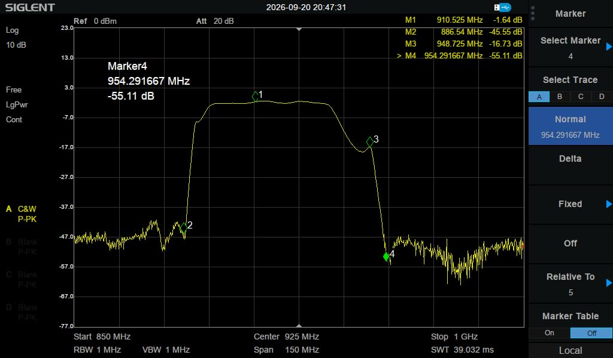{ .constrained-image }

| Marker | Frequency | Response | What it shows |
|---|---|---|---|
| M1 | 910.5 MHz | -1.6 dB | Insertion loss in the passband - this is the MeshCore US frequency |
| M2 | 886.5 MHz | -45.6 dB | Lower edge - signals below here are knocked down ~45 dB |
| M3 | 948.7 MHz | -16.7 dB | Upper shoulder - rejection is gentler on the high side |
| M4 | 954.3 MHz | -55.1 dB | Above here, signals are knocked down 45 dB or more |

In plain terms: the response is flat across the vendor's 902-928 MHz passband and starts to roll off just outside it, which is consistent with that being the 3 dB bandwidth. Signals you actually want lose about **1.5 dB**. Anything below about **886 MHz** or above about **954 MHz** is reduced by **45 dB or more** - a factor of over 30,000 in power.

---

## Other Filter Options

The filter tested here trades a little extra loss for something the size of a thumb that costs less than a decent antenna - easy to throw on a portable, vehicle, or tree node.

If you need lower insertion loss or tighter rejection close to the band - for example, on a permanent repeater at a busy tower site - a cavity filter is the step up. Cavity filters can get insertion loss well under 1 dB and have much steeper skirts, but they are also big, heavy, and expensive.

!!! warning "Get it tuned to your channel"
    Many cavity filters have a far narrower passband than the filter tested here - often just a few MHz wide instead of the full 902-928 MHz band. That's what gives them their sharp rejection, but it also means a filter tuned for one frequency can have **several dB of loss** on another. A filter built for the Meshtastic US default (906.875 MHz), for example, is a poor fit for MeshCore's 910.525 MHz. Order it tuned to the exact frequency your node uses, and if you run more than one network through the same antenna, make sure every frequency falls inside the passband.

Cavity filter makers popular with the LoRa mesh community:

| Maker | Notes | Link |
|---|---|---|
| **ACASOM** | Several 915 MHz cavity filter variants originally aimed at Helium and LoRaWAN gateways. Sold mainly through AliExpress, and also rebranded under other names such as Callboost - check the passband specs, not just the brand | [AliExpress](https://www.aliexpress.com/w/wholesale-915-cavity-filter.html){ .md-button } |
| **Airframes** | 4 MHz-wide cavity filters pre-tuned for common Meshtastic and MeshCore frequencies, including 910.525 MHz | [Airframes](https://shop.airframes.io/products/lora-915mhz-filter){ .md-button } |
| **BayMesh** | Hand-tuned cavity filters (BM3, BM4, BM5) made by Nullrouten of the Bay Area mesh community, shipped with a measured spec sheet | [BayMesh](https://bayme.sh/){ .md-button } |

Amazon's selection of 915 MHz cavity filters is limited right now, but the search is here if you want to check:

[Search Amazon for 915 MHz cavity filters](https://www.amazon.com/s?k=915+mhz+cavity+filter&tag=csrameshcore-20){ .md-button }

---

!!! info "Next steps"
    - [Hardware Guide](hardware.md) - antennas and power options
    - [DIY Builds overview](diy-builds.md) - enclosures and build examples
    - [Network Coverage](network.md) - see where the CSRA repeaters are
